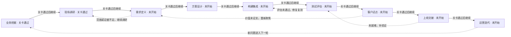
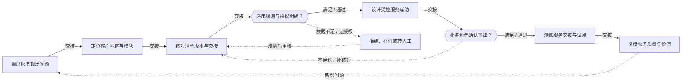
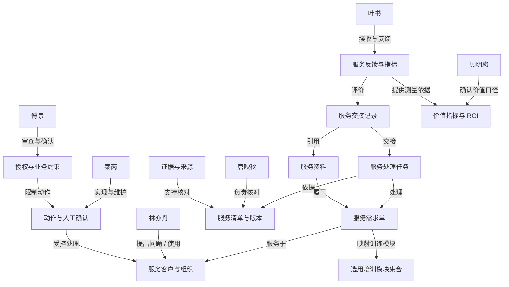

# 出院随访与患者协作 · 项目练习 1

## 当前实践模块

- 出院随访与患者协作（healthcare）

## 项目可选模块

- 出院随访与患者协作（healthcare）

## 模块已访谈证据（待核实）

- [healthcare / healthcare-f01] 顾明岚：患者名单从 HIS 导出，护士手工分组、打电话、写记录，再发给专科。
- [healthcare / healthcare-f20] 唐映秋：护士筛查 → 专科确认 → 必要时安排复诊；诊疗决策由医生承担。
- [healthcare / healthcare-f23] 唐映秋：交接要带出院批次、授权状态、专科问卷和护士确认记录、当前版本和未解决事项。接手人明确确认后才结束本岗待办，发送消息不等于责任已转移。
- [healthcare / healthcare-f53] 叶书：各部门的完成时间要分别记录。7 天随访完成率 85%，红旗事件全部升级 的分母、统计周期和排除规则由业务负责人固定，不能用消息发送量代替实际完成量。
- [healthcare / healthcare-f54] 叶书：下游反馈必须关联原业务编号和当时的资料版本；由患者服务经理受理，专科医生核实，未确认前不承诺赔偿或结果。
- [healthcare / healthcare-f10] 林亦舟：电话号码失效、患者在上班、方言理解困难，三次未接就搁置。
- [healthcare / healthcare-f12] 林亦舟：一次完整随访约 12 分钟，其中 4 分钟是重复填写记录。
- [healthcare / healthcare-f11] 林亦舟：患者提到呼吸困难等危险信号时，需要立即按医院既有流程升级，不能继续问卷。
- [healthcare / healthcare-f15] 林亦舟：每条辅助结果必须显示原记录。涉及危险症状、联系人身份不明或患者撤回授权时，先由专科医生核对；未经确认的结果不能覆盖原记录。
- [healthcare / healthcare-f05] 顾明岚：首期只覆盖骨科常规术后患者的随访安排与记录。先历史回放、再并行试点，不能直接关掉现有人工流程。
- [healthcare / healthcare-f02] 顾明岚：先试点骨科常规术后患者，考核触达率、人工工时和红旗事件漏报率。
- [healthcare / healthcare-f21] 唐映秋：不同术式随访问卷不同，模板要由专科审核后发布，不能使用通用建议。
- [healthcare / healthcare-f22] 唐映秋：AI 可以整理患者陈述，不能作诊断、调整用药或代替医生签名。
- [healthcare / healthcare-f32] 秦芮：现有只读患者名单接口，没有自动开处方或挂号的授权接口。
- [healthcare / healthcare-f34] 秦芮：试点数据按每日一次刷新，原文按版本同步。超过一个周期的结果标注待刷新；历史快照不能伪装成当前状态。
- [healthcare / healthcare-f52] 叶书：先做安排与记录辅助，不做自主诊疗；急症提示需由院方专业人员审定。
- [healthcare / healthcare-f50] 叶书：患者更希望晚间接听，老年患者可能需要家属协助，不能只推手机链接。

# FDE 全流程训练记录

项目：出院随访与患者协作

训练者填写的任务和角色评审记录；不自动证明真实客户授权、生产上线或实际收益。

## 1. 业务挖掘

从经营目标、真实事件和指标基线中判断是否值得立项。

### 识别业务机会

交付：业务机会清单

状态：已完成 · 责任人：当前练习者

证据：当前练习访谈与案例资料

我的理解：
本次场景为骨科术后出院随访与患者协作。客户表层提出想要AI自动打电话的功能诉求，根源触发事件是随访患者量大、护士外呼负荷高；但真正要改善的业务结果，不是单纯削减护士人手，而是稳定随访时效、降低文书返工复核成本、补齐风险上报与交接留痕规则，同时严格约束AI的自动化边界，AI仅承担随访记录结构化预填、排程辅助，不做诊疗判断、调药、代签。现状流程为：HIS导出患者名单 → 护士手工分组 → 电话外呼 → 手写随访记录 → 转发给专科医生【healthcare‑f01】。单次随访总耗时12分钟，其中4分钟消耗在重复填写随访记录上【healthcare‑f12】；当前执行规则是三次联系不上患者即搁置随访，存在院后康复安全隐患，识别到危险信号时需要按院内原有流程升级上报【healthcare‑f10、healthcare‑f11】；随访交接仅凭消息转发，必须接手人确认后才算交接闭环，仅发送消息不能认定交接完成【healthcare‑f23】；随访完成口径不能直接用消息发送量等价于随访完成，试点计划以触达率、人工工时节约、红旗事件漏报率作为验收指标，但指标的分母、统计周期、排除规则还没有固化【healthcare‑f53】；HIS仅开放只读接口，不支持处方、挂号相关信息自动写入【healthcare‑f32】。

判断依据：
1. 林亦舟（一线护士，已访谈）：提供一线工时、触达失败场景、现场操作习惯，给出风险升级阈值的一线建议，但该建议尚未得到护理部审批；证据编号：f01、f10、f11、f12
2. 顾明岚（护理部负责人，已访谈）：明确排程、触达归属护理部，掌握试点预算与最终决策权；提出授权映射需要信息科与质控共同确认；证据编号：f53
3. 秦芮（信息工程师，已访谈）：确认接口只读限制、数据快照版本能力；提出授权变更确认责任人尚不明确，存在责任空档；证据编号：f32、f34
4. 唐映秋（专科医生，已访谈）：限定AI不能越权开展诊疗工作，专科问卷需要专科审核定稿；证据编号：f21、f22
5. 叶书（患者服务经理，已访谈）：提出项目不建议将减少人手作为第一目标，和原始“护士打不过来”的诉求存在目标张力；证据编号：f50
6. 傅景（隐私质控，未访谈）：隐私、记录留存、审计、授权审批相关信息全部空白，不能当作已证实依据。

矛盾与张力：
①授权责任空档：顾明岚说明排程触达归护理部，但授权映射需要信息科+质控确认；秦芮表示授权变更确认人未核实，存在责任缺口。
②目标优先级分歧：原始诉求是护士随访负荷过重，叶书不建议把减人作为项目首要目标。
③风险阈值未闭环：林亦舟给出了升级阈值的现场建议，但顾明岚没有确认审批，该阈值只属于一线提议，不是落地规则。

仍待核实的问题：
1. 向顾明岚核实：触达失败转人工、通知家属的正式阈值，以及试点验收指标（触达率、工时、红旗漏报率）的统计规则、排除口径。
2. 向唐映秋核实：专科随访问卷的定稿责任人、版本留痕、迭代审核机制，以及诊疗风险的责任划分。
3. 向秦芮核实：授权变更确认主体、只读接口下交接确认留痕的技术可行性、系统故障降级方案、字段写入权限范围。
4. 向叶书核实：随访投诉受理流程、患者服务与专科医生之间的核实分工闭环机制。
5. 后续完成傅景访谈，确认随访授权变更审批、患者隐私保护、随访记录留存、审计核查的合规红线。

### 建立现状基线

交付：指标基线与价值假设

状态：已完成 · 责任人：当前练习者

证据：当前练习访谈与案例资料

本任务是为骨科术后出院随访场景建立可验证的现状基线，核心是定义时效、返工、复核类指标，明确每个指标的分子、分母、统计时间窗、样本来源与测量责任人，区分**已有访谈估计值**和**待采样验证数据**，不能直接把口头估算当作确定基线。
现状流程：HIS 导出患者名单→护士手工分组→电话外呼→手写随访记录→转发专科医生【healthcare-f01】。
目前已知估算信息：单次完整随访总耗时 12 分钟，其中 4 分钟用于重复填写随访记录，属于文书复核返工耗时【healthcare-f12】；当前触达规则为连续 3 次呼叫未接通即搁置随访，存在红旗风险事件漏报的可能【healthcare-f10、f11】；随访交接依靠消息转发，缺少接手人确认环节，存在交接返工、责任追溯困难问题【healthcare-f23】；随访完成口径不能等同于消息发送量【healthcare-f53】。

判断依据：

1. 林亦舟（一线护士，已访谈）：提供单条随访工时拆分、呼叫失败处置方式，工时数据为一线经验估算，需要抽样复测；证据编号：f01、f10、f11、f12
2. 顾明岚（护理部负责人，已访谈）：负责基线指标审批、确定统计周期与样本抽样规则，是基线测量责任人；证据编号：f53
3. 秦芮（信息工程师，已访谈）：可从 HIS 导出随访患者名单、呼叫日志，提供原始样本数据源；接口仅只读，无法自动抓取手工记录的返工时长；证据编号：f32、f34
4. 唐映秋（专科医生，已访谈）：负责复核随访异常记录，可统计记录错误、问卷填写不合规带来的复核返工量；证据编号：f21、f22
5. 叶书（患者服务经理，已访谈）：可统计随访相关投诉量，作为基线中患者体验侧指标；证据编号：f50
6. 傅景（隐私质控，未访谈）：审计、记录留存合规相关基线规则暂未获取，属于待采集项。

指标基线说明（区分估算值 / 待采集）：

1. 单随访工时基线：总时长 12min / 例，文书填写 4min / 例，**当前为护士经验估计，需要抽样验证**；分子：护士实际操作时长；分母：有效随访样本；时间窗：7 天随访周期；样本来源：骨科术后出院患者；测量责任人：林亦舟、顾明岚
2. 触达失败搁置率基线：估算为三次未接直接搁置；分子：呼叫 3 次未接通后搁置的随访；分母：全部随访任务；时间窗：7 天；样本来源：HIS 导出随访清单；测量责任人：林亦舟
3. 红旗事件漏报率基线：暂无现成数据，属于**待采集**；分子：本应上报但未识别上报的风险事件；分母：全部随访样本；时间窗：7 天；样本来源：专科复核记录；测量责任人：唐映秋
4. 交接返工率基线：暂无现成数据，**待采集**；分子：交接信息不全、需要二次确认返工的随访；分母：发生交接的随访；时间窗：7 天；样本来源：交接聊天记录、专科退回记录；测量责任人：唐映秋、林亦舟

仍待核实的问题：

1. 向顾明岚确认：基线抽样样本量、抽样周期，确定基线合格判定标准；确认搁置随访、红旗事件的统计排除规则。
2. 向林亦舟采集抽样样本：现场计时采集真实随访工时，验证 “12 分钟总时长、4 分钟文书耗时” 的估算是否准确，统计真实的呼叫搁置数量。
3. 向唐映秋统计：随访记录错误、问卷不合规的复核返工案例数量，建立返工率基线。
4. 向秦芮确认：HIS 日志能够提供哪些字段，能不能自动统计呼叫次数，哪些数据只能人工采集。
5. 向叶书采集随访相关投诉样本，建立投诉量基线。
6. 完成傅景访谈，确认合规审计类基线指标的统计要求。

### 确认立项与决策链

交付：项目章程与利益相关者地图

状态：已完成 · 责任人：当前练习者

证据：当前练习访谈与案例资料

本任务目标是明确骨科出院随访项目立项信息、完整决策链，识别全部利益相关方，区分发起人、使用者、出资方、审批人，划定访谈授权、调查边界、数据访问权限，明确谁承担业务结果、谁批准范围、谁批准数据访问、谁有权决定项目继续或停止，所有未经访谈确认的角色、权限、结论统一标注【待核实 / 待访谈确认】，不做预设推断。
本次项目范围限定：骨科术后出院随访场景试点，仅引入 AI 辅助随访记录，不改动院内诊疗方案、不修改 HIS 写入能力；所有患者隐私数据采集、使用规则以访谈和院内合规要求为准。

判断依据：

1. 林亦舟（一线护士，使用者）：随访执行人员，提供一线痛点、参与试点试用、反馈使用效果；证据编号：f01、f10、f12
2. 顾明岚（护理部负责人，业务发起人）：确认业务目标、试点范围、验收指标；证据编号：f01、f02、f05；**尚未确认出资权、最终审批权、项目叫停权，相关权限待核实**
3. 秦芮（信息工程师，技术支撑）：仅可提供 HIS 只读接口、每日数据刷新、版本同步能力，无处方 / 挂号写入接口，不负责系统改造落地；证据编号：f32、f34
4. 唐映秋（专科医生，复核使用者，诊疗责任人）：承担随访异常的诊疗决策责任、交接责任，明确边界：**发送消息不等于责任转移**，消息转发仅为信息传递，未完成确认交接前，原有责任不转移；证据编号：f20、f23
5. 叶书（患者服务经理，体验相关方）：定义随访完成口径，收集随访投诉、评估患者体验；证据编号：f53
6. 傅景（隐私质控）：**未访谈，角色、权限待确认**，暂不预设为既定合规审批节点，数据访问审批权限需要访谈后核实。

访谈授权与调查边界：

- 授权范围：仅调研骨科出院随访的时效、返工、复核成本；仅采集随访台账、呼叫记录、复核退回记录；
- 数据访问边界：仅使用 HIS 只读能力，不可写入、修改 HIS 原始数据；数据访问的审批主体待傅景访谈确认；
- 决策链现状：一线反馈→护理部发起立项→【合规审批节点待访谈确认】→信息部提供只读数据支撑→试点验收；出资方、最终叫停决策者暂未明确。

核心问题答复：

1. 业务结果承担者：顾明岚（护理部），【待本人确认】
2. 项目范围批准者：顾明岚，【待本人确认】
3. 数据访问批准者：傅景，【待访谈确认】
4. 项目继续 / 停止决策者：顾明岚联合院方，【待核实】

仍待核实的问题：

1. 向顾明岚确认：项目出资方、预算审批流程，以及项目叫停条件、验收签字人；
2. 完成傅景访谈，确认：数据访问审批权限、患者隐私采集字段清单、脱敏与存储规则；
3. 确认项目终止触发清单：发生哪些风险事件时，审批方可以叫停试点；
4. 确认出资方角色，补齐完整决策链。

关卡：业务负责人确认问题、指标口径与调查范围

{"status":"通过","reviewer":"大模型任务评审","evidence":"opportunity-trigger：72分；opportunity-baseline：78分；opportunity-mandate：72分","decision":"三项任务均已完成模型评分并通过，已保存关卡评审，可导出报告并进入下一环节。","updatedAt":"2026-11-05T06:02:43.122Z"}

## 2. 现场调研

还原实际流程，用多角色和多来源材料核实问题。

### 开展角色访谈

交付：访谈记录与角色地图

状态：已完成 · 责任人：当前练习者

证据：当前练习访谈与案例资料

本次业务机会表层诉求是护士电话随访工作量大、人手不足，希望引入 AI 辅助随访；真正需要改善的业务结果，是优化出院随访全流程的时效、减少文书返工、建立规范的风险升级与交接留痕机制，同时严格划定 AI 自动化边界，AI 仅做记录结构化预填、排程辅助，不承担诊疗决策、诊断、调药、代签等工作【healthcare‑f01、healthcare‑f12、healthcare‑f21】。
现状流程：HIS 导出患者名单→护士手工分组→电话外呼→手写随访记录→转发给专科医生【healthcare‑f01】。单次随访合计 12 分钟，其中 4 分钟消耗在重复填写随访记录上【healthcare‑f12】；目前规则为三次联系不上患者就搁置随访，存在临床安全隐患，危险信号需要走原有医院升级流程【healthcare‑f10、healthcare‑f11】；随访交接依靠消息转发，必须接手人确认才算交接完成，单纯发送消息不能视为交接闭环【healthcare‑f23】；随访完成口径不能用消息发送量代替真实随访完成，试点考核指标暂定触达率、人工工时节约、红旗事件漏报率，但指标的分母、统计周期、排除规则尚未固定，有待业务负责人确认【healthcare‑f53】；系统仅开放只读患者名单接口，不支持处方、挂号类自动写入授权【healthcare‑f32】。

### 还原现状流程

交付：现状流程图与异常路径

状态：已完成 · 责任人：当前练习者

证据：当前练习访谈与案例资料

本任务目标是还原清禾综合医院**出院随访与患者协作**的现状流程，梳理触发、输入、交接、人工判断、正常输出、全部异常分支；在瓶颈节点标注准确责任人，区分已核实访谈事实和待核实事项，回答访谈核对问题：理想流程与现场做法差异、哪些判断只能由人完成，绑定对应访谈证据编号。
本次首期试点范围限定：仅覆盖骨科常规术后患者，先历史回放、并行试点，不可直接关停现有人工流程（f05）；验收指标为触达率、人工工时、红旗事件漏报率（f02）。

判断依据：

1. 林亦舟（一线护士，随访执行）：从 HIS 导出随访名单、手工分组、电话呼叫、记录随访信息；单次随访约 12 分钟，其中 4 分钟用于重复填写记录；呼叫 3 次未接通则搁置随访，护士仅可提出升级建议，升级阈值由护理部确定；证据编号：f01、f10、f12
2. 顾明岚（护理部负责人，业务负责人）：确定试点范围、验收指标、随访完成口径、呼叫失联后的升级阈值；证据编号：f02、f05、f53
3. 唐映秋（专科医生）：接收随访异常信息，做红旗事件风险判断；交接规则：**发消息不等于责任转移，交接必须由接手人确认才算闭环**；危险症状、联系人身份不明、患者撤回授权场景，必须由专科先核对，未经确认不能覆盖原有记录；护士筛查红旗信号后交由专科确认，必要时安排复诊；证据编号：f11、f15、f20、f23
4. 秦芮（信息工程师）：仅提供 HIS 只读名单接口、每日刷新能力，无处方 / 挂号写入接口；支持历史快照，快照不能伪装成当前状态；证据编号：f32、f34
5. 叶书（患者服务经理）：负责受理患者投诉反馈，反馈工单必须关联原业务编号与资料版本；专科核实前，不向患者承诺赔偿或结果；随访完成口径由业务负责人固定，不能用消息发送代替完成量；患者偏好晚间接听、老年患者常需要家属协助触达，不适合只推送手机链接；证据编号：f50、f53、f54
6. 傅景（隐私质控）：未访谈，隐私信息传递、记录留存审计、合规边界待确认。

访谈核对问题作答：

1. 理想流程与现场做法差异：
现场现状：依赖护士人工执行全流程，呼叫触达受患者接听习惯约束；交接仅确认 “发消息不等于责任转移”，**现场交接渠道、留痕方式待核实**；无系统自动校验，危险信号、授权变更等风险都依靠人工识别。
理想流程属于待验证假设，不在现状还原内：标准化触达时段、结构化表单、交接确认留痕、风险前置校验。
2. 只能由人完成的判断：
① 患者症状的医学风险判断、红旗事件识别（f11,f20）；
② 危险症状、身份不明、授权撤回等场景的专科核对（f15）；
③ 是否需要紧急复诊、升级处置的医疗决策；
④ 交接闭环确认，接手人核验信息后确认办结（f23）；
⑤ 患者投诉、纠纷的核实与响应（f54）。

仍待核实的问题：

1. 随访启动的标准时间窗口；
2. 三次呼叫失败后正式升级路径、通知对象；
3. 傅景访谈确认隐私合规、随访记录留存审计要求；
4. 设备采集数据是否纳入随访内容、对应的审核责任人；
5. 交接实际使用的渠道、书面留痕方式。

### 四来源收敛与材料核对

交付：四来源收敛表、证据台账与问题清单

状态：已完成 · 责任人：当前练习者

证据：当前练习访谈与案例资料

本任务为**四来源收敛与材料核对**，围绕清禾综合医院出院随访与患者协作事件，对齐四类信息源：Buyer 业务目标、Brief 书面范围、Industry 技术可行性、Operator 现场故障；利用访谈记录、制度、单据、观察记录交叉核验事实，识别口径冲突、保留分歧；同时回答核对问题：确认每项说法对应的支撑记录，校验时间、版本、样本口径是否一致，最终产出四来源收敛表、证据台账、问题清单。

判断依据：

1. Buyer（顾明岚，护理部，业务负责人）业务目标：首期试点仅覆盖骨科常规术后患者，先历史回放、并行试点，不直接关停人工流程；验收指标为触达率、人工工时、红旗事件漏报率；随访 7 天完成率 85%、红旗事件全部升级；随访完成口径固定，不能以消息发送代替随访完成；证据编号：f02、f05、f53
2. Brief 书面范围：
   - 随访采集信息、风险升级规则：检出危险信号立即升级、停止问卷；危险症状、联系人身份不明、患者撤回授权，必须专科先核对，未经确认不能覆盖原有记录；交接必须接手人确认闭环，发消息不等于责任转移；患者反馈投诉需关联原业务编号与版本，核实前不承诺结果；触达适配患者习惯，支持晚间接听、老年家属协助，不可仅推送链接；证据编号：f11、f15、f23、f50、f54
3. Industry（秦芮，信息工程师）技术可行性：仅提供 HIS 只读名单接口、每日刷新、历史快照能力；无处方、挂号写入接口；历史快照不能伪装为当前状态；无法自动完成医学风险判断、自动交接确认；证据编号：f32、f34
4. Operator（林亦舟、唐映秋，一线操作人员）现场故障 / 现状痛点：护士手工导出分组、手工填写记录，单次随访 12 分钟，其中 4 分钟重复录入；连续 3 次呼叫未接通搁置，护士仅提升级建议，升级阈值由护理部拍板；交接渠道、留痕方式待核实；证据编号：f01、f10、f12
5. 傅景（隐私质控）：未访谈，隐私、审计留存规则无支撑材料。

访谈核对问题作答：

- 支撑记录：所有业务规则、现状痛点均来自对应编号访谈记录；
- 口径一致性检查：
 一致项：首期试点范围、验收指标、HIS 只读能力、红旗事件升级要求、交接闭环规则；
分歧 / 不一致项：业务目标希望提升触达率，但现场受患者接听习惯、老年需家属协助约束；业务希望标准化交接留痕，但现场交接渠道、留痕方式尚未核实；技术侧无法自动替代人工医学判断、交接确认。
仍待核实的问题：
1. 随访启动时间窗口制度文件，核对业务目标与现场执行时间口径；
2. 隐私合规、记录留存审计规则（傅景访谈），确认数据版本、留存周期；
3. 三次呼叫失败升级阈值的正式书面制度，对齐业务目标和一线操作；
4. 交接的正式渠道、留痕单据，验证交接闭环规则落地方式；
5. 设备采集数据是否纳入随访范围，确认是否在 Brief 范围之内。

关卡：关键流程、异常、证据矛盾和待核实项已形成记录

{"status":"通过","reviewer":"大模型任务评审","evidence":"discovery-interviews：62分；discovery-process：78分；discovery-evidence：72分","decision":"三项任务均已完成模型评分并通过，已保存关卡评审，可导出报告并进入下一环节。","updatedAt":"2026-11-05T06:08:46.320Z"}

## 3. 需求定义

把调查发现收敛为有证据、可验收、可追责的需求。

### 确定优先问题

交付：问题优先级与机会判断

状态：未开始 · 责任人：未填写

证据：未填写

尚无训练记录

### 编写需求与边界

交付：需求规格与追溯矩阵

状态：未开始 · 责任人：未填写

证据：未填写

尚无训练记录

### 约定验收标准

交付：验收清单与需求确认记录

状态：未开始 · 责任人：未填写

证据：未填写

尚无训练记录

关卡：问题优先级、需求范围和可测验收条件均有确认记录

{"status":"待确认"}

## 4. 方案设计

以最小试点验证价值，设计数据、系统和人工控制。

### 选定最小试点

交付：试点方案与方案比较

状态：未开始 · 责任人：未填写

证据：未填写

尚无训练记录

### 设计数据和系统边界

交付：架构图、数据与权限矩阵

状态：未开始 · 责任人：未填写

证据：未填写

尚无训练记录

### 报价与投入产出测算

交付：项目报价、首年ROI测算与实施评估计划

状态：未开始 · 责任人：未填写

证据：未填写

尚无训练记录

关卡：试点边界、方案取舍、数据权限与实施计划已评审

{"status":"待确认"}

## 5. 构建集成

实现可运行的最小闭环，使规则、模型与人工责任可追溯。

### 落实数据与工具契约

交付：数据契约与集成记录

状态：未开始 · 责任人：未填写

证据：未填写

尚无训练记录

### 实现业务闭环

交付：原型代码与版本说明

状态：未开始 · 责任人：未填写

证据：未填写

尚无训练记录

### 实现异常与审计

交付：异常处理与审计样例

状态：未开始 · 责任人：未填写

证据：未填写

尚无训练记录

关卡：指定版本可复现运行，异常和人工交接路径完整

{"status":"待确认"}

## 6. 测试评估

证明行为与需求一致，区分模拟验证、真实模型验证与业务验收。

### 建立评估集合

交付：评估集与需求覆盖表

状态：未开始 · 责任人：未填写

证据：未填写

尚无训练记录

### 执行测试与重复评估

交付：测试报告与评估结果

状态：未开始 · 责任人：未填写

证据：未填写

尚无训练记录

### 修复并回归确认

交付：缺陷闭环与质量结论

状态：未开始 · 责任人：未填写

证据：未填写

尚无训练记录

关卡：评估范围、版本、失败项、修复复测与剩余风险可审查

{"status":"待确认"}

## 7. 客户试点

在受控范围中验证实际采用和业务收益。

### 准备受控试点

交付：试点执行计划

状态：未开始 · 责任人：未填写

证据：未填写

尚无训练记录

### 开展用户验收

交付：用户验收与反馈记录

状态：未开始 · 责任人：未填写

证据：未填写

尚无训练记录

### 核对价值与继续决定

交付：试点收益复核与决策纪要

状态：未开始 · 责任人：未填写

证据：未填写

尚无训练记录

关卡：试点对照、用户反馈、退出条件与扩大范围决定有记录

{"status":"待确认"}

## 8. 上线交接

把通过试点的版本交给具名负责人，明确上线和回退责任。

### 审查上线准备

交付：上线准备检查与三方评审

状态：未开始 · 责任人：未填写

证据：未填写

尚无训练记录

### 演练发布与回滚

交付：发布计划与回滚演练记录

状态：未开始 · 责任人：未填写

证据：未填写

尚无训练记录

### 完成运维和用户交接

交付：交接清单、运行手册与签收记录

状态：未开始 · 责任人：未填写

证据：未填写

尚无训练记录

关卡：业务、技术和风险角色的上线准备及交接决定有依据

{"status":"待确认"}

## 9. 运营迭代

持续观察价值、质量和成本，形成下一轮业务发现。

### 建立持续运营节奏

交付：30/60/90天运营计划

状态：未开始 · 责任人：未填写

证据：未填写

尚无训练记录

### 演练事件与变更管理

交付：事件复盘与变更记录

状态：未开始 · 责任人：未填写

证据：未填写

尚无训练记录

### 复盘并启动下一轮发现

交付：项目复盘、迭代清单与作品集

状态：未开始 · 责任人：未填写

证据：未填写

尚无训练记录

关卡：运营节奏、事件闭环、复盘及下一轮优先级已确认

{"status":"待确认"}

# FDE阶段成果与追溯

项目：出院随访与患者协作
练习：c3c6358f-26bf-465c-ae97-00b348379938

- 报告 REPORT-97cbf6dc-0c71-44c0-9a78-695b3ef70b77 v2：清禾综合医院 · 业务需求发现报告

## 业务挖掘 · stale

成果：ART-e8f72491-6832-4679-ba6d-4066adacc1e5 v1

输入：REPORT-c2d8979b-34ef-4455-93a7-7b24dc1c2411 v1

围绕出院随访与患者协作整理业务挖掘。以下为基于已保存输入的待完善草稿。

### 业务机会清单

上游输入：清禾综合医院 · 业务需求发现报告 v1：现有事实显示，门诊后随访的主要瓶颈不在“打电话”这一动作本身，而在名单分组、触达失败处置、记录重复填写与跨部门交接口径四处：名单从 HIS 导出后靠护士手工分组与手写记录（healthcare-f01），联系不上时三次未接即搁置（healthcare-f10），单次随访 12 分钟中约 4 分钟用于重复填写（healthcare-f12）；同时完成率口径、红旗升级分母与投诉归属均有明确约束（healthcare-f53、healthcare-f54），诊疗决策与交接确认不可由 AI 替代（healthcare-f20、healthcare-f23）。据此，切入点应优先放在“排程与记录辅助＋触达失败升级规则”，而非自主诊疗或自动判定完成。当前覆盖率 7/36，仅为阶段性发现，不构成验收依据。

本步整理：收集最近一次异常事件，区分客户提出的功能和真正要改善的业务结果。

待明确：哪个具体事件触发了需求？如果维持现状，会产生什么损失？
边界：只读核对与人工交接；合成训练不代表真实授权、业务执行或客户验收

引用：healthcare-f01、healthcare-f10、healthcare-f12、healthcare-f20、healthcare-f23、healthcare-f53、healthcare-f54

### 指标基线与价值假设

上游输入：清禾综合医院 · 业务需求发现报告 v1：现有事实显示，门诊后随访的主要瓶颈不在“打电话”这一动作本身，而在名单分组、触达失败处置、记录重复填写与跨部门交接口径四处：名单从 HIS 导出后靠护士手工分组与手写记录（healthcare-f01），联系不上时三次未接即搁置（healthcare-f10），单次随访 12 分钟中约 4 分钟用于重复填写（healthcare-f12）；同时完成率口径、红旗升级分母与投诉归属均有明确约束（healthcare-f53、healthcare-f54），诊疗决策与交接确认不可由 AI 替代（healthcare-f20、healthcare-f23）。据此，切入点应优先放在“排程与记录辅助＋触达失败升级规则”，而非自主诊疗或自动判定完成。当前覆盖率 7/36，仅为阶段性发现，不构成验收依据。

本步整理：定义指标分子、分母、时间窗、样本来源和测量责任人，缺失数据列为待采集。

待明确：现状耗时、返工和错误如何计算？哪些数字还只是估计？
边界：只读核对与人工交接；合成训练不代表真实授权、业务执行或客户验收

引用：healthcare-f01、healthcare-f10、healthcare-f12、healthcare-f20、healthcare-f23、healthcare-f53、healthcare-f54

### 项目章程与利益相关者地图

上游输入：清禾综合医院 · 业务需求发现报告 v1：现有事实显示，门诊后随访的主要瓶颈不在“打电话”这一动作本身，而在名单分组、触达失败处置、记录重复填写与跨部门交接口径四处：名单从 HIS 导出后靠护士手工分组与手写记录（healthcare-f01），联系不上时三次未接即搁置（healthcare-f10），单次随访 12 分钟中约 4 分钟用于重复填写（healthcare-f12）；同时完成率口径、红旗升级分母与投诉归属均有明确约束（healthcare-f53、healthcare-f54），诊疗决策与交接确认不可由 AI 替代（healthcare-f20、healthcare-f23）。据此，切入点应优先放在“排程与记录辅助＋触达失败升级规则”，而非自主诊疗或自动判定完成。当前覆盖率 7/36，仅为阶段性发现，不构成验收依据。

本步整理：明确业务发起人、使用者、出资者、审批者，记录访谈授权与调查边界。

待明确：谁承担结果？谁批准范围、数据访问及继续或停止？
边界：只读核对与人工交接；合成训练不代表真实授权、业务执行或客户验收

引用：healthcare-f01、healthcare-f10、healthcare-f12、healthcare-f20、healthcare-f23、healthcare-f53、healthcare-f54

需求：
- REQ-1 随访排程与分组可由系统按出院批次生成，护士仅做确认；负责人护理部负责人（顾明岚）会同信息工程师；验收取一个骨科出院批次做离线对照：人工分组结果与按批次＋授权状态生成的排程逐条比对，统计差异条目；由信息工程师确认授权映射字段是否存在，质控专员确认触达对象边界，护士长签字确认后方可进入试点。；依据healthcare-f01
- REQ-2 触达失败需设定转人工/通知家属的阈值规则，否则红旗升级链路断裂；负责人护理部负责人拍板，随访护士提供现场建议；验收由护理部组织一次规则定稿会，输出未接次数、时限、转人工对象与家属通知条件的书面版本；用历史未接案例回放验证规则能否覆盖已知红旗场景，急症提示文案须经院方专业人员审定。；依据healthcare-f10、healthcare-f12
- REQ-3 结构化预填可压缩重复记录时间，护士确认后入库；负责人随访护士（林亦舟）与信息工程师；验收选 10 例已完成随访做回溯：记录人工填写字段与可由患者陈述预填字段的重合度，测算可节省分钟数；同时确认专科问卷模板定稿人与版本留痕方式，未定稿前不进入开发。；依据healthcare-f12、healthcare-f20、healthcare-f23
- REQ-4 完成率与红旗升级指标须先固定口径，再谈自动化统计；负责人患者服务经理（叶书）牵头，业务负责人固定规则；验收由叶书出具一页口径说明（分子分母、统计周期、排除规则、完成判定依据），经业务负责人签认；用一个月历史数据按新旧口径各算一次，差异需逐项解释后才可作为试点考核基线。；依据healthcare-f53、healthcare-f54
- REQ-5 交接包需含批次、授权状态、问卷版本与未解决事项，接手人确认才结待办；负责人专科医生（唐映秋）与护理部共同确认；验收抽取近期若干次护士转专科的实际交接记录，检查六项要素的缺失率；与信息工程师确认现有系统能否留存版本与确认时间戳，缺失项列入需求清单而非直接承诺。；依据healthcare-f23、healthcare-f54
- REQ-6 AI 介入边界应限定为安排与记录辅助，诊疗与承诺类动作保留人工；负责人隐私与质控专员（傅景）审定；验收安排隐私与质控专员访谈，输出“可自动/须人工确认/禁止自动”三类动作清单；试点方案逐条对照该清单签署，未列入清单的动作一律不启用。；依据healthcare-f20、healthcare-f54

遗留项：书面Brief、行业可行性与现场测量是否已经核对？；本阶段责任人应补齐具体决定、执行证据与未解决事项。

确认：{"status":"待确认"}

## 现场调研 · missing

待生成；输入不足时先返回上游补齐。

## 需求定义 · missing

待生成；输入不足时先返回上游补齐。

## 方案设计 · missing

待生成；输入不足时先返回上游补齐。

## 构建集成 · missing

待生成；输入不足时先返回上游补齐。

## 测试评估 · missing

待生成；输入不足时先返回上游补齐。

## 客户试点 · missing

待生成；输入不足时先返回上游补齐。

## 上线交接 · missing

待生成；输入不足时先返回上游补齐。

## 运营迭代 · missing

待生成；输入不足时先返回上游补齐。

## 需求如何归纳

先从已采集事实形成问题假设，再约定业务结果、范围、失败控制和验收。缺少的来源标记待补，不能把六人访谈完整率当作四来源收敛或需求确认。

### 业务流程拆解

要回答：问题发生在哪一步，为什么要这样划分智能体？

1. 先画人工现状泳道，写出触发、输入、8–15个处理步骤、交接和异常。
2. 区分判断点与执行点；按使用的数据、权限、模型能力与失败方式组合执行步骤。
3. 在不可逆动作前设置确定性校验；为低置信、缺资料、冲突和越权安排具名人工接收人。

交付链：现状流程 → 失败方式 → 智能体/工具边界 → 校验与人工升级路径

原文：frameworks/workflow-decomposition.md

### 业务结果与不可逆风险矩阵

要回答：多个需求中，先做哪个最小可验证方案？

1. 列出3–5个候选切入点，分别说明改善的业务结果、现状基线和投入。
2. 评估失败何时被谁看见、能否在损害前拦截、是否可以撤销；不要把模型置信度等同于业务风险。
3. 优先选择高价值、可拦截且可恢复的切入点；高风险需硬约束和责任人否决权，价值或风险未知先补证据。

交付链：候选方案 → 价值/风险比较 → 选择与暂缓理由 → 验收指标与停止条件

原文：frameworks/outcome-risk-matrix.md

### 四来源收敛

要回答：谁说要做，哪里真的坏了，范围允许什么，技术是否可行？

1. Buyer：核实业务目标、预算、优先级和决定权；Operator：用最近一单还原真实操作和失败位置。
2. Brief：核对书面目标、范围、时间和排除项；Industry：寻找可比技术实践，并核实本项目的数据与接口差异。
3. 检查四个视角是否指向同一瓶颈。分歧保留在问题清单：一线帮助定位故障，决策者确认价值，Brief约束范围，行业证据帮助判断可行性。

交付链：四视角陈述与来源 → 收敛/分歧 → 待核实问题 → 有边界的需求假设

原文：frameworks/4-source-convergence.md

### 本次四来源核对

- Buyer · 业务决策者：顾明岚
  状态：已采集角色陈述，目标和预算仍待确认；已采集依据：healthcare-f01、healthcare-f05、healthcare-f02
- Brief · 书面需求：出院患者很多，护士打电话打不过来。希望 AI 帮我们做随访，但我们还没想清楚哪些环节可以自动化。
  状态：当前只有场景开场；书面Brief原文与版本待补；已采集依据：暂无
- Industry · 行业可行性：需要可比技术案例、数据条件和接口能力的核验材料。企业业务介绍不能证明技术可行。
  状态：待补行业实践与本项目适用性验证；已采集依据：暂无
- Operator · 一线使用者：林亦舟
  状态：已采集现场陈述，仍需样本与操作观察核实；已采集依据：healthcare-f10、healthcare-f12、healthcare-f11、healthcare-f15

### 从证据到候选需求

- REQ-1 随访记录结构化预填可释放护士工时
  依据：healthcare-f12、healthcare-f01、healthcare-f15
  推导：一次完整随访约12分钟，其中4分钟为重复填写记录（healthcare-f12），且名单导出后手工分组、手写记录（healthcare-f01）。若将患者陈述结构化预填、护士确认后入库，可压缩重复劳动并让护士专注异常。不确定处：预填字段范围、确认后是否覆盖原记录，需与复核规则（healthcare-f15）对齐。
  判断：候选需求；需用结果与不可逆风险矩阵比较，P0/P1/P2不等于已完成价值风险评分。
  下一步：取一批历史骨科随访记录做离线回放，比较人工填写与预填后确认的耗时差；以“确认后入库、原记录可追溯”为验收前提，由护士长人工确认字段清单。
- REQ-2 触达失败需明确转人工阈值，否则危险信号传不进来
  依据：healthcare-f10、healthcare-f11、healthcare-f50
  推导：电话失效、上班、方言导致三次未接即搁置（healthcare-f10），而危险信号必须立即按既有流程升级、不能继续问卷（healthcare-f11）。触达失败与升级规则目前无事实支撑，属关键缺口。患者偏好晚间接听、老年患者需家属协助（healthcare-f50），说明单一渠道会放大漏接。
  判断：候选需求；需用结果与不可逆风险矩阵比较，P0/P1/P2不等于已完成价值风险评分。
  下一步：由护理部牵头开一次阈值确认会，产出“未接次数—转人工时限—通知家属条件”草案；用历史未接样本回放测算漏报率，人工确认后再进试点。
- REQ-3 专科问卷模板的定稿人与版本留痕未定，制约自动化边界
  依据：healthcare-f21、healthcare-f22、healthcare-f23
  推导：不同术式问卷不同，模板须专科审核后发布，不能用通用建议（healthcare-f21）；AI只能整理陈述，不能诊断、调药或代签（healthcare-f22）。唐映秋明确模板定稿与版本留痕“尚未核实”。这是自动化能否落地的前置条件，缺失则无法定义哪些内容可自动生成。
  判断：候选需求；需用结果与不可逆风险矩阵比较，P0/P1/P2不等于已完成价值风险评分。
  下一步：访谈唐映秋确认模板定稿责任人、审核频次与版本标识方式；由秦芮说明现有系统能否承载版本字段，形成书面口径后再评估自动初稿范围。
- REQ-4 交接以“接手人确认”为责任转移点，需系统化承载
  依据：healthcare-f23、healthcare-f01、healthcare-f32
  推导：交接须带出院批次、授权状态、问卷、护士确认记录、当前版本与未解决事项，接手人明确确认后才结束待办，发消息不等于责任转移（healthcare-f23）。当前流程靠手工分组与转发表（healthcare-f01），责任边界易模糊。不确定处：系统是否支持确认动作留痕，现有仅只读名单接口（healthcare-f32）。
  判断：候选需求；需用结果与不可逆风险矩阵比较，P0/P1/P2不等于已完成价值风险评分。
  下一步：梳理一次真实交接的字段与确认动作，请秦芮评估在只读接口条件下能否先做确认记录而非自动写入；以“确认动作可追溯”为最小验收点。
- REQ-5 完成率与红旗升级口径须先固定，否则试点无法验收
  依据：healthcare-f53、healthcare-f02、healthcare-f54
  推导：7天随访完成率85%、红旗事件全部升级的分母、周期与排除规则须由业务负责人固定，不能用消息发送量代替实际完成量（healthcare-f53）；试点验收本身考核触达率、人工工时与红旗漏报率（healthcare-f02）。口径不统一会先转化为患者端投诉（healthcare-f54）。
  判断：候选需求；需用结果与不可逆风险矩阵比较，P0/P1/P2不等于已完成价值风险评分。
  下一步：由叶书与顾明岚共同出具指标定义单页，明确分母、周期、排除项；试点前用历史数据试算一次，人工核对分子分母是否一致。
- REQ-6 授权映射与数据刷新需版本化，禁止自动改写
  依据：healthcare-f32、healthcare-f34
  推导：现有仅只读名单接口，无自动开处方或挂号授权接口（healthcare-f32）；试点数据每日刷新、原文按版本同步，超周期结果标注待刷新，历史快照不得伪装当前状态（healthcare-f34）。授权变更由谁确认尚未核实，属不可逆风险点，宜先做版本留存而非自动更新。
  判断：候选需求；需用结果与不可逆风险矩阵比较，P0/P1/P2不等于已完成价值风险评分。
  下一步：访谈傅景确认授权变更的确认人与留痕要求；秦芮给出字段级“可自动写入/仅留存”清单，人工评审后再定试点数据流。

## Demo执行证据

尚未执行绑定Demo评估。

## 阶段练习与训练评分

## 历史版本

保留1个旧版本。JSON导出包含原始报告、成果版本和完整输入引用。

# 出院随访与患者协作 · ROI测算

尚未保存ROI测算。

# 出院随访与患者协作 · FDE业务流程与Ontology

练习：项目练习 1

阶段进度与关卡来自本次练习；业务流程与对象关系为建模定义，不代表实际业务已经执行。

对象生命周期：服务任务：提出 → 待核实 → 待确认 → 已交接；未结项继续跟踪

选用模块：
- 出院随访与患者协作（healthcare）

## FDE 项目处理流程

九阶段主线、阶段关卡和返工路径。完成与通过状态来自本次练习记录。

### 业务挖掘 · FDE阶段

从经营目标、真实事件和指标基线中判断是否值得立项。

关联阶段：业务挖掘

本次状态：关卡通过 · 3/3项任务

关卡：业务负责人确认问题、指标口径与调查范围

- 业务机会清单
- 指标基线与价值假设
- 项目章程与利益相关者地图

### 现场调研 · FDE阶段

还原实际流程，用多角色和多来源材料核实问题。

关联阶段：现场调研

本次状态：关卡通过 · 3/3项任务

关卡：关键流程、异常、证据矛盾和待核实项已形成记录

- 访谈记录与角色地图
- 现状流程图与异常路径
- 四来源收敛表、证据台账与问题清单

### 需求定义 · FDE阶段

把调查发现收敛为有证据、可验收、可追责的需求。

关联阶段：需求定义

本次状态：未开始 · 0/3项任务

关卡：问题优先级、需求范围和可测验收条件均有确认记录

- 问题优先级与机会判断
- 需求规格与追溯矩阵
- 验收清单与需求确认记录

### 方案设计 · FDE阶段

以最小试点验证价值，设计数据、系统和人工控制。

关联阶段：方案设计

本次状态：未开始 · 0/3项任务

关卡：试点边界、方案取舍、数据权限与实施计划已评审

- 试点方案与方案比较
- 架构图、数据与权限矩阵
- 项目报价、首年ROI测算与实施评估计划

### 构建集成 · FDE阶段

实现可运行的最小闭环，使规则、模型与人工责任可追溯。

关联阶段：构建集成

本次状态：未开始 · 0/3项任务

关卡：指定版本可复现运行，异常和人工交接路径完整

- 数据契约与集成记录
- 原型代码与版本说明
- 异常处理与审计样例

### 测试评估 · FDE阶段

证明行为与需求一致，区分模拟验证、真实模型验证与业务验收。

关联阶段：测试评估

本次状态：未开始 · 0/3项任务

关卡：评估范围、版本、失败项、修复复测与剩余风险可审查

- 评估集与需求覆盖表
- 测试报告与评估结果
- 缺陷闭环与质量结论

### 客户试点 · FDE阶段

在受控范围中验证实际采用和业务收益。

关联阶段：客户试点

本次状态：未开始 · 0/3项任务

关卡：试点对照、用户反馈、退出条件与扩大范围决定有记录

- 试点执行计划
- 用户验收与反馈记录
- 试点收益复核与决策纪要

### 上线交接 · FDE阶段

把通过试点的版本交给具名负责人，明确上线和回退责任。

关联阶段：上线交接

本次状态：未开始 · 0/3项任务

关卡：业务、技术和风险角色的上线准备及交接决定有依据

- 上线准备检查与三方评审
- 发布计划与回滚演练记录
- 交接清单、运行手册与签收记录

### 运营迭代 · FDE阶段

持续观察价值、质量和成本，形成下一轮业务发现。

关联阶段：运营迭代

本次状态：未开始 · 0/3项任务

关卡：运营节奏、事件闭环、复盘及下一轮优先级已确认

- 30/60/90天运营计划
- 事件复盘与变更记录
- 项目复盘、迭代清单与作品集

## 出院随访与患者协作 · 业务处理流程

合成案例的业务结构示意，作为访谈核对与方案设计的起点；节点不表示该步骤已经执行。

### 提出服务现场问题 · 业务事件

从选用模块中的一线事件提出具体困扰

关联阶段：业务挖掘

责任视角：林亦舟

- 角色提出的事件和问题

### 定位客户地区与模块 · 处理活动

限定本次演练对象和业务口径

关联阶段：现场调研

责任视角：唐映秋

- 输入、处理依据、输出和交接责任需要用项目证据核对

### 核对清单版本与交接 · 处理活动

用模块访谈、样本与规则核实问题

关联阶段：需求定义

责任视角：唐映秋

- 输入、处理依据、输出和交接责任需要用项目证据核对

### 适用规则与授权明确？ · 判断关卡

地区、版本或授权不明确时先澄清

关联阶段：方案设计

责任视角：傅景

- 输入、处理依据、输出和交接责任需要用项目证据核对

### 设计受控服务辅助 · 处理活动

围绕选定模块提交自己的方案和实现

关联阶段：构建集成

责任视角：秦芮

- 输入、处理依据、输出和交接责任需要用项目证据核对

### 业务角色确认输出？ · 判断关卡

逐模块核对缺项、来源与人工控制

关联阶段：测试评估

责任视角：傅景

- 输入、处理依据、输出和交接责任需要用项目证据核对

### 演练服务交接与试点 · 处理活动

清楚区分已确认项与未结项

关联阶段：客户试点、上线交接

责任视角：叶书

- 输入、处理依据、输出和交接责任需要用项目证据核对

### 复盘服务质量与价值 · 业务事件

按模块复核时效、返工与ROI，进入下一轮

关联阶段：运营迭代

责任视角：顾明岚

- 反馈、运营指标和新需求

### 拒绝、补件或转人工 · 业务约束

只读核对与人工交接；合成训练不代表真实授权、业务执行或客户验收

关联阶段：需求定义、测试评估

- 保留原因、来源和处理责任；问题澄清后重新核对

## 出院随访与患者协作 · Ontology 业务对象图

用“角色—对象—关系—动作—约束—价值”连接业务与实现。对象属性和生命周期是待证据核对的定义，不是生产系统实例。

### 顾明岚 · 参与角色

护理部负责人：我关心业务价值、决策与试点范围。

关联阶段：业务挖掘、现场调研

- 现场事件：出院患者很多，护士打电话打不过来。希望 AI 帮我们做随访，但我们还没想清楚哪些环节可以自动化。
- 对其影响：待核实
- 提出的问题：我关心业务价值、决策与试点范围。

### 林亦舟 · 参与角色

随访护士：我可以讲具体经历、现场习惯和复核方式。

关联阶段：业务挖掘、现场调研

- 现场事件：出院患者很多，护士打电话打不过来。希望 AI 帮我们做随访，但我们还没想清楚哪些环节可以自动化。
- 对其影响：待核实
- 提出的问题：我可以讲具体经历、现场习惯和复核方式。

### 唐映秋 · 参与角色

专科医生：我熟悉流程、材料、交接与责任。

关联阶段：业务挖掘、现场调研

- 现场事件：出院患者很多，护士打电话打不过来。希望 AI 帮我们做随访，但我们还没想清楚哪些环节可以自动化。
- 对其影响：待核实
- 提出的问题：我熟悉流程、材料、交接与责任。

### 秦芮 · 参与角色

医院信息工程师：我负责系统、数据、更新与故障处理。

关联阶段：业务挖掘、现场调研

- 现场事件：出院患者很多，护士打电话打不过来。希望 AI 帮我们做随访，但我们还没想清楚哪些环节可以自动化。
- 对其影响：待核实
- 提出的问题：我负责系统、数据、更新与故障处理。

### 傅景 · 参与角色

隐私与质控专员：我关注风险、权限、留存和审计。

关联阶段：业务挖掘、现场调研

- 现场事件：出院患者很多，护士打电话打不过来。希望 AI 帮我们做随访，但我们还没想清楚哪些环节可以自动化。
- 对其影响：待核实
- 提出的问题：我关注风险、权限、留存和审计。

### 叶书 · 参与角色

患者服务经理：我可以说明下游口径、投诉和反馈。

关联阶段：业务挖掘、现场调研

- 现场事件：出院患者很多，护士打电话打不过来。希望 AI 帮我们做随访，但我们还没想清楚哪些环节可以自动化。
- 对其影响：待核实
- 提出的问题：我可以说明下游口径、投诉和反馈。

### 服务客户与组织 · 业务对象

客户/组织标识、服务地区、业务范围

关联阶段：现场调研、需求定义、方案设计

- 客户/组织标识
- 服务地区
- 业务范围

### 服务需求单 · 业务对象

需求ID、服务对象、地区、时间

关联阶段：现场调研、需求定义、方案设计

- 需求ID
- 服务对象
- 地区
- 时间

### 选用培训模块集合 · 业务对象

模块ID、业务线、训练范围

关联阶段：现场调研、需求定义、方案设计

- 模块ID
- 业务线
- 训练范围

### 服务清单与版本 · 业务对象

规则ID、适用地区、生效期、审定角色

关联阶段：现场调研、需求定义、方案设计

- 规则ID
- 适用地区
- 生效期
- 审定角色

### 服务处理任务 · 业务对象

任务ID、来源需求、责任角色、状态

关联阶段：构建集成、测试评估、客户试点、运营迭代

- 任务ID
- 来源需求
- 责任角色
- 状态

### 服务资料 · 业务对象

资料项、需求关联、版本、可见范围

关联阶段：构建集成、测试评估、客户试点、运营迭代

- 资料项
- 需求关联
- 版本
- 可见范围

### 服务交接记录 · 业务对象

交接对象、确认项、未结项、依据

关联阶段：构建集成、测试评估、客户试点、运营迭代

- 交接对象
- 确认项
- 未结项
- 依据

### 服务反馈与指标 · 业务对象

返工、时效、异常、测量口径

关联阶段：构建集成、测试评估、客户试点、运营迭代

- 返工
- 时效
- 异常
- 测量口径

### 动作与人工确认 · 受控动作

按权限调用工具、提交审核、记录决定；动作不能自行改变批准状态。

关联阶段：方案设计、构建集成、测试评估、上线交接

- 动作输入
- 责任角色
- 前置条件
- 副作用和审计

### 授权与业务约束 · 业务约束

只读核对与人工交接；合成训练不代表真实授权、业务执行或客户验收

关联阶段：方案设计、构建集成、测试评估、上线交接

- 只读核对与人工交接；合成训练不代表真实授权、业务执行或客户验收

### 证据与来源 · 证据来源

角色陈述、样本、制度、系统记录分别核对，未核实项保留状态。

关联阶段：方案设计、构建集成、测试评估、上线交接

- 来源ID
- 版本/时间
- 适用范围
- 核实状态

### 价值指标与 ROI · 价值指标

记录本场景的时效、返工和复核成本，基线须按样本验证

关联阶段：业务挖掘、客户试点、运营迭代

- 业务量与时间基线
- 采用率与兑现率
- 建设/运行成本
- 测算依据

# FDE项目示范

尚未运行完整示范。